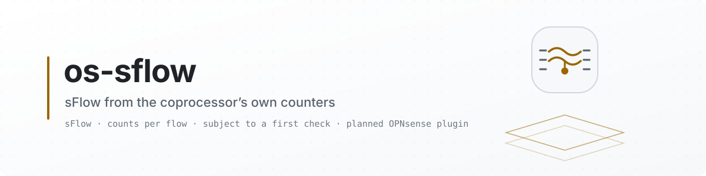

<picture>
  <source media="(prefers-color-scheme: dark)" srcset="docs/images/readme/banner-dark.svg">
  <source media="(prefers-color-scheme: light)" srcset="docs/images/readme/banner-light.svg">
  
</picture>

  
  
  
  

# sFlow Export for OPNsense

sFlow from the coprocessor's counters - planned subject to a first check, since sFlow expects packet samples and the hardware keeps counts per flow.

> **Planned - nothing here runs yet.** This repository was opened on 2026-11-16 to hold
> sFlow Export as a plugin of its own. No code has been written or moved into it, and there is no
> release.

## What it is to do

- a first check: what the hardware counters can give an sFlow collector;
- export to a collector set on the page, if the check allows it;
- NetFlow from OPNsense kept as it is.

## Where it fits

It is one part of the [os-xgs-npu](https://github.com/AbdelmonemAwad/os-xgs-npu) project, which puts OPNsense on Sophos XGS hardware, and works the way its other plugins do: changes by pull request, a release installed from **XGS: Updates**, its Arabic in [opnsense-arabic](https://github.com/AbdelmonemAwad/opnsense-arabic)'s catalogue.

## Licence

BSD 2-Clause - see [LICENSE](LICENSE).
